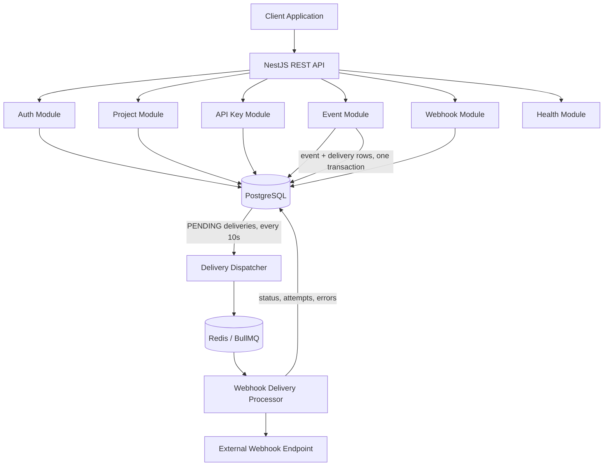

# Ereignix

**A multi-tenant event ingestion and webhook delivery platform.**

Ereignix lets applications send events through a project-scoped API key and automatically delivers those events, signed and with retries, to the webhook endpoints that subscribed to them.

It is built with NestJS, TypeScript, PostgreSQL (Prisma) and BullMQ/Redis, with a focus on backend architecture, security, asynchronous processing and maintainability.

## Table of Contents

- [Features](#features)
- [Tech Stack](#tech-stack)
- [Architecture](#architecture)
- [Getting Started](#getting-started)
- [Environment Variables](#environment-variables)
- [Docker](#docker)
- [API Overview](#api-overview)
- [Roles and Permissions](#roles-and-permissions)
- [Webhook Delivery](#webhook-delivery)
- [Webhook Signature Verification](#webhook-signature-verification)
- [Data Model](#data-model)
- [Testing](#testing)
- [Security Considerations](#security-considerations)
- [Project Structure](#project-structure)
- [Current Limitations and Future Improvements](#current-limitations-and-future-improvements)
- [License](#license)

## Features

### Authentication and Authorization
- User registration (creates the user, an organization and an `OWNER` membership in one transaction) and login.
- JWT access tokens (15 minutes) and refresh tokens (7 days).
- Refresh token rotation: every refresh revokes the used token and issues a new pair.
- Refresh token revocation on logout. Refresh tokens are stored hashed (bcrypt), identified by a `jti`.
- Password hashing with bcrypt and password complexity validation.
- Role-based access control scoped to the organization in the URL.

### Organizations and Projects
- Organization-based resource isolation.
- Multiple projects per organization.
- Organization member roles: `OWNER`, `ADMIN`, `DEVELOPER`, `VIEWER`.
- Project CRUD with role-based permissions.

### API Keys
- Project-scoped API keys in the format `evg_live_<keyId>_<secret>`.
- The raw key is shown only once, at creation. Only the SHA-256 hash of the secret is stored.
- Timing-safe verification.
- Revocation (revoked keys are rejected immediately).
- `lastUsedAt` tracking.

### Event Ingestion
- Authenticated ingestion with the `x-api-key` header (no user JWT needed).
- JSON object payloads, stored per project.
- Optional idempotency key (unique per project), including protection against concurrent duplicate requests.
- Matching enabled webhook endpoints are found and delivery records are created in the same database transaction as the event.

### Webhook Endpoints
- Create, list and delete webhook endpoints per project.
- Each endpoint subscribes to one or more exact event names (up to 50).
- Per-endpoint signing secret, generated server-side, returned once at creation and encrypted at rest (AES-256-GCM).
- HTTPS-only URL validation with private/reserved IP and SSRF protections.

### Asynchronous Webhook Delivery
- Background processing with BullMQ and Redis (concurrency of 10 jobs per instance).
- Database-backed dispatcher that polls pending deliveries every 10 seconds and enqueues them.
- Recovery of deliveries stuck in `PROCESSING`.
- HMAC-SHA256 signed requests.
- Up to 5 attempts with exponential backoff.
- Delivery status, attempt count, last error and response code tracked in PostgreSQL.

### Operations
- Swagger / OpenAPI documentation.
- Liveness and readiness probes.
- Structured logging with Pino.
- Global validation (`whitelist` and `forbidNonWhitelisted`) and a global exception filter.

## Tech Stack

| Category | Technology |
|---|---|
| Language | TypeScript |
| Runtime | Node.js 22 |
| Framework | NestJS 11 |
| Database | PostgreSQL |
| ORM | Prisma 7 (`@prisma/adapter-pg`) |
| Queue | BullMQ (`@nestjs/bullmq`) |
| Queue storage | Redis |
| Scheduling | `@nestjs/schedule` |
| Authentication | JWT (`@nestjs/jwt`, Passport) |
| Password hashing | bcrypt |
| Logging | Pino (`nestjs-pino`) |
| API documentation | Swagger / OpenAPI |
| Validation | class-validator, class-transformer |
| IP validation | ipaddr.js |
| Testing | Jest, Supertest |
| Containerization | Docker, Docker Compose |

## Architecture

Ereignix is a modular NestJS application. Controllers handle HTTP, services expose each module's API, and use cases hold the business logic for individual operations.



### Event Delivery Flow

1. A client sends an event to `POST /v1/events` with a project API key.
2. The API key is parsed, verified against its stored hash and checked for revocation.
3. If an `idempotencyKey` is provided and already exists for the project, the existing event is returned and nothing new is created.
4. In a single transaction, the event is stored and a `PENDING` delivery is created for every enabled endpoint in the project subscribed to that event name.
5. The dispatcher (cron, every 10 seconds) selects up to 100 due `PENDING` deliveries and adds a BullMQ job for each one (job ID `delivery-<id>`, so a delivery is never queued twice at the same time).
6. A worker loads the delivery, marks it `PROCESSING`, re-validates the endpoint URL, signs the payload and sends the HTTP POST.
7. On a 2xx response the delivery becomes `SUCCEEDED`. Otherwise it goes back to `PENDING` with a `nextAttemptAt` and is retried, or becomes `FAILED` after the final attempt.

Because ingestion only writes to PostgreSQL, event requests never wait on external webhook endpoints. PostgreSQL is the source of truth, so pending work survives a Redis restart.

## Getting Started

### Prerequisites

- Node.js 22 (the Docker image uses `node:22-alpine`)
- npm
- PostgreSQL
- Redis
- Docker (optional)

### 1. Clone the repository

```bash
git clone <YOUR_REPOSITORY_URL>
cd ereignix
```

### 2. Install dependencies

```bash
npm install
```

### 3. Configure environment variables

```bash
cp .env.example .env
```

Fill in the values described in [Environment Variables](#environment-variables). Generate a 32-byte encryption key with:

```bash
openssl rand -base64 32
```

Use the output as `WEBHOOK_ENCRYPTION_KEY`. Generate a strong random value for `JWT_SECRET` as well.

> **Important:** never commit `.env` files, JWT secrets or encryption keys. Losing or changing `WEBHOOK_ENCRYPTION_KEY` makes existing webhook secrets undecryptable.

### 4. Generate the Prisma client and run migrations

The Prisma client is generated into `generated/prisma` (git-ignored), so it must be generated after cloning:

```bash
npx prisma generate
npx prisma migrate deploy
```

When creating new migrations during development, use `npx prisma migrate dev` instead.

### 5. Start PostgreSQL and Redis

Make sure both are running and reachable with the settings in your `.env`.

### 6. Run the application

```bash
# development (watch mode)
npm run start:dev

# production build
npm run build
npm run start:prod
```

The API listens on `http://localhost:3000` unless `PORT` is set. All versioned routes use the `/v1` prefix.

- Swagger UI: `http://localhost:3000/api/docs`
- Liveness: `GET /v1/health/live`
- Readiness: `GET /v1/health/ready`

## Environment Variables

| Variable | Required | Description |
|---|---|---|
| `DATABASE_URL` | Yes | PostgreSQL connection string. |
| `REDIS_HOST` | No (default `localhost`) | Redis host used by BullMQ. |
| `REDIS_PORT` | No (default `6379`) | Redis port. |
| `JWT_SECRET` | Yes | Secret used to sign access and refresh tokens. |
| `WEBHOOK_ENCRYPTION_KEY` | Yes | Base64-encoded 32-byte key used to encrypt webhook secrets (AES-256-GCM). The app refuses to start without a valid key. |
| `NODE_ENV` | No | Set to `production` to disable pretty-printed logs. |
| `LOG_LEVEL` | No (default `info`) | Pino log level. |
| `PORT` | No (default `3000`) | HTTP port. |

Tests use a separate `.env.test.local` file (see [Testing](#testing)).

## Docker

The `Dockerfile` is a multi-stage build (`node:22-alpine`). On startup the container runs `prisma migrate deploy` and then starts the compiled app.

`docker-compose.yml` runs the **app** and **Redis** (with persistence). **PostgreSQL is not included**, so you must provide a database the container can reach.

1. Create a `.env.docker` file (git-ignored) with the variables above.
2. Point the services at the right hosts. Inside a container, `localhost` refers to the container itself:
   - `REDIS_HOST=redis` (the Compose service name)
   - `DATABASE_URL` must use a host reachable from the container, for example `host.docker.internal` for a database running on your machine.
3. Start the stack:

```bash
docker compose up --build
```

To run only the image against services you already have:

```bash
docker build -t ereignix .
docker run --env-file .env.docker -p 3000:3000 ereignix
```

## API Overview

Interactive documentation is available at `/api/docs`. Routes under `/v1/organizations/...` and `/v1/auth/me` require a user access token (`Authorization: Bearer <token>`). `/v1/events` requires a project API key.

### Authentication

| Method | Endpoint | Auth | Description |
|---|---|---|---|
| POST | `/v1/auth/register` | Public | Register a user and create their organization |
| POST | `/v1/auth/login` | Public | Log in and receive tokens |
| POST | `/v1/auth/refresh` | Refresh token | Rotate the token pair |
| POST | `/v1/auth/logout` | Refresh token | Revoke a refresh token |
| GET | `/v1/auth/me` | Access token | Get the authenticated user |

### Projects

| Method | Endpoint | Description |
|---|---|---|
| POST | `/v1/organizations/:organizationId/projects` | Create a project |
| GET | `/v1/organizations/:organizationId/projects` | List projects |
| GET | `/v1/organizations/:organizationId/projects/:projectId` | Get a project |
| PATCH | `/v1/organizations/:organizationId/projects/:projectId` | Update a project |
| DELETE | `/v1/organizations/:organizationId/projects/:projectId` | Delete a project |

### API Keys

Base path: `/v1/organizations/:organizationId/projects/:projectId/api-keys`

| Method | Endpoint | Description |
|---|---|---|
| POST | `/` | Create an API key (the raw key is returned only once) |
| GET | `/` | List API keys |
| DELETE | `/:apiKeyId` | Revoke an API key |

### Event Ingestion

| Method | Endpoint | Auth | Description |
|---|---|---|---|
| POST | `/v1/events` | `x-api-key` header | Ingest an event |

| Field | Type | Rules |
|---|---|---|
| `name` | string | Required, 1–100 characters. Matched exactly against endpoint subscriptions. |
| `payload` | object | Required JSON object. |
| `idempotencyKey` | string | Optional, 1–255 characters, unique per project. |

```bash
curl -X POST http://localhost:3000/v1/events \
  -H "Content-Type: application/json" \
  -H "x-api-key: YOUR_PROJECT_API_KEY" \
  -d '{
    "name": "order.created",
    "payload": {
      "orderId": "order_123",
      "amount": 99.99,
      "currency": "USD"
    },
    "idempotencyKey": "order-created-123"
  }'
```

Sending the same `idempotencyKey` again returns the originally stored event instead of creating a duplicate or new deliveries.

### Webhook Endpoints

Base path: `/v1/organizations/:organizationId/projects/:projectId/webhook-endpoints`

| Method | Endpoint | Description |
|---|---|---|
| POST | `/` | Create a webhook endpoint (the signing secret is returned only once) |
| GET | `/` | List webhook endpoints (secrets are never returned) |
| DELETE | `/:endpointId` | Delete a webhook endpoint and its subscriptions |

Create request body:

```json
{
  "name": "Order notifications",
  "url": "https://example.com/webhooks/orders",
  "eventNames": ["order.created", "order.cancelled"]
}
```

`eventNames` accepts 1–50 names, each up to 100 characters, matching `^[a-zA-Z0-9][a-zA-Z0-9._-]*$`. Wildcards are not supported.

### Health

| Method | Endpoint | Description |
|---|---|---|
| GET | `/v1/health/live` | Liveness probe |
| GET | `/v1/health/ready` | Readiness probe (checks the database connection) |

## Roles and Permissions

Roles are checked per organization using the `organizationId` in the route.

| Action | OWNER | ADMIN | DEVELOPER | VIEWER |
|---|:---:|:---:|:---:|:---:|
| List / get projects | ✅ | ✅ | ✅ | ✅ |
| Create / update projects | ✅ | ✅ | ✅ | ❌ |
| Delete projects | ✅ | ✅ | ❌ | ❌ |
| List API keys | ✅ | ✅ | ✅ | ✅ |
| Create / revoke API keys | ✅ | ✅ | ❌ | ❌ |
| List webhook endpoints | ✅ | ✅ | ✅ | ✅ |
| Create webhook endpoints | ✅ | ✅ | ✅ | ❌ |
| Delete webhook endpoints | ✅ | ✅ | ❌ | ❌ |

## Webhook Delivery

| Behavior | Value |
|---|---|
| Method | `POST` with a JSON body |
| Request timeout | 10 seconds |
| Redirects | Not followed (a 3xx response counts as a failure) |
| Success | Any 2xx response |
| Maximum attempts | 5 |
| Backoff | Exponential, starting at 1 second (1s, 2s, 4s, 8s) |
| Worker concurrency | 10 jobs per application instance |
| Dispatcher interval | Every 10 seconds, up to 100 deliveries per run |
| Stale recovery | Deliveries stuck in `PROCESSING` for 5+ minutes are returned to `PENDING` |

Delivery status values: `PENDING`, `PROCESSING`, `SUCCEEDED`, `FAILED`.

If an endpoint is disabled when a delivery is processed, the delivery is marked `FAILED`.

### Request body

```json
{
  "id": 42,
  "name": "order.created",
  "payload": { "orderId": "order_123", "amount": 99.99, "currency": "USD" },
  "createdAt": "2026-11-05T08:00:00.000Z"
}
```

`id` is the event ID.

### Request headers

| Header | Description |
|---|---|
| `Content-Type` | `application/json` |
| `User-Agent` | `Ereignix-Webhook/1.0` |
| `X-Ereignix-Event` | Event name |
| `X-Ereignix-Delivery` | Delivery ID (stable across retries) |
| `X-Ereignix-Timestamp` | Unix timestamp in seconds |
| `X-Ereignix-Signature` | `sha256=<hex HMAC-SHA256 signature>` |

## Webhook Signature Verification

The signature is computed as:

```text
hex( HMAC-SHA256( webhook_secret, timestamp + "." + raw_request_body ) )
```

and sent as `sha256=<hex>`. To verify a delivery:

1. Read the **raw** request body (do not re-serialize parsed JSON).
2. Compute the HMAC with your endpoint's secret over `` `${timestamp}.${rawBody}` ``.
3. Compare it to the received signature with a timing-safe comparison.
4. Optionally reject timestamps that are too old to limit replay attacks.

```js
import { createHmac, timingSafeEqual } from 'node:crypto';

function verify(secret, timestamp, rawBody, signatureHeader) {
  const expected =
    'sha256=' +
    createHmac('sha256', secret).update(`${timestamp}.${rawBody}`).digest('hex');

  const a = Buffer.from(expected);
  const b = Buffer.from(signatureHeader);
  return a.length === b.length && timingSafeEqual(a, b);
}
```

Delivery is **at-least-once**. Deduplicate on `X-Ereignix-Delivery`, since retries and recovery can send the same delivery more than once.

## Data Model

Main entities (see `prisma/schema.prisma`; a DBML sketch is in `docs/schema.dbml` and may lag behind the Prisma schema):

- `User`, `Organization`, `Member` (user ↔ organization with a role)
- `Project` (belongs to an organization)
- `ApiKey` (belongs to a project)
- `RefreshToken` (belongs to a user)
- `Event` (belongs to a project, unique on `projectId` + `idempotencyKey`)
- `WebhookEndpoint` and `WebhookSubscription` (event names an endpoint listens to)
- `WebhookDelivery` (one per event and endpoint, unique on `eventId` + `endpointId`)

Deleting a project cascades to its API keys, events, endpoints and deliveries.

## Testing

End-to-end tests (`*.e2e-spec.ts`) live inside each module, with shared setup in `test/`.

```bash
npm run test:e2e      # end-to-end tests (run serially)
```

E2E tests need a **dedicated test database**:

1. Copy `.env.test.local.example` to `.env.test.local`.
2. Set `DATABASE_URL` to a database whose URL contains `test`. The setup aborts with "Wrong DB detected" otherwise, to protect real data.
3. Set the Redis variables. Make sure `JWT_SECRET` and `WEBHOOK_ENCRYPTION_KEY` are available to the test run (from `.env` or `.env.test.local`).

Migrations are applied automatically before the E2E run.

E2E coverage includes authentication (register, login, refresh, logout, me), project management, API key management, event ingestion and idempotency, webhook endpoint management, role-based authorization and health checks. The delivery dispatcher and processor do not have automated tests yet.

## Security Considerations

- Passwords hashed with bcrypt; password complexity enforced.
- Short-lived access tokens; refresh tokens stored hashed, rotated on use and revocable.
- Role-based authorization checked against the organization in the route.
- API keys: 256-bit random secrets, SHA-256 hashed at rest, timing-safe comparison, revocable.
- Webhook secrets: encrypted at rest with AES-256-GCM (versioned format) and never returned after creation.
- Webhook URL validation, applied at creation **and** again before every delivery:
  - HTTPS only, standard port 443 only, no embedded credentials.
  - Blocks `localhost` and `.local`, `.internal`, `.test`, `.invalid` hostnames.
  - Resolves DNS and rejects hostnames that resolve to private, loopback, link-local or otherwise reserved addresses (IP literals are checked directly).
- Redirects are not followed on webhook requests; requests time out after 10 seconds.
- HMAC-SHA256 signatures with a timestamp for receiver-side verification.
- Idempotent ingestion that also handles concurrent duplicate requests.
- Strict input validation (unknown properties are rejected).

Webhook delivery is designed for **at-least-once** processing, not exactly-once.

For production, add infrastructure-level egress restrictions. The URL is validated and then resolved again by the HTTP client, so a DNS-rebinding window remains until requests are pinned to the validated IP.

## Project Structure

```text
src/
├── main.ts                      # Bootstrap: URI versioning (/v1), Pino logger, Swagger
├── app.module.ts                # Root module, global validation pipe and exception filter
├── config/                      # Swagger configuration
├── general/                     # Shared guards, decorators, strategies, types, utils
│   ├── guards/                  # JwtAuthGuard, RolesGuard, ApiKeyAuthGuard
│   ├── decorators/              # @CurrentUser, @CurrentApiKey, @Roles, ...
│   └── strategies/              # Passport JWT strategy
├── security/                    # PasswordService, TokenService, JWT setup
├── infra/
│   ├── prisma/                  # Prisma module and service
│   ├── queue/                   # Queue and job name constants
│   ├── logger/                  # Pino logger module
│   └── filters/                 # Global exception filter
└── modules/
    ├── auth/                    # Register, login, refresh, logout, me
    ├── account/                 # Transactional user + organization + owner membership creation
    ├── user/                    # User and membership lookups
    ├── organization/            # Organization helpers (slug generation)
    ├── project/                 # Project CRUD
    ├── api-key/                 # API key generation, hashing, listing, revocation
    ├── event/                   # Event ingestion
    ├── webhook/                 # Endpoints, URL validation, secret encryption,
    │                            #   delivery dispatcher and delivery processor
    └── health/                  # Liveness and readiness probes

prisma/                          # schema.prisma and migrations
generated/prisma/                # Generated Prisma client (git-ignored)
docs/                            # Database diagram (DBML)
test/                            # E2E configuration and setup
```

Most modules follow the same layout: `controller` → `service` → `use-case/` files, with `dto/` for request and response shapes and `*.e2e-spec.ts` next to the module.

## Current Limitations and Future Improvements

Current limitations:

- Webhook endpoints can be created, listed and deleted, but not updated. The `enabled` flag exists in the database and is respected by delivery, but there is no API to toggle it yet.
- Registration creates one organization per user. The data model supports multiple memberships, but there are no APIs yet for inviting members or changing roles.
- There are no API endpoints for delivery history or manual retries; delivery state is currently visible only in the database.
- Readiness checks only the database, not Redis.

Planned improvements:

- Endpoint update/enable/disable APIs and delivery history with manual retry.
- Member invitation and role management.
- Stronger distributed delivery claiming and processing leases.
- DNS pinning and outbound network controls for webhook requests.
- Tests for the dispatcher and delivery processor.
- Observability and delivery metrics.
- CI/CD pipeline and automated deployment.

## License

This project is currently a software engineering portfolio project.